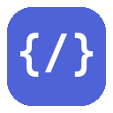

<div align="center">
  

  # 结构化文档工作台

  **在本机提取、解析并格式化 JSON / XML**

  一款零权限、零依赖的 Microsoft Edge 扩展，支持日志文本过滤、交互式文档树、搜索复制和本地历史记录。

  <p>
    <a href="https://microsoftedge.microsoft.com/addons/detail/%E7%BB%93%E6%9E%84%E5%8C%96%E6%96%87%E6%A1%A3%E5%B7%A5%E4%BD%9C%E5%8F%B0/lgappabghgabcpnpbbliphfhdceioflp">
      
    </a>
    <a href="https://github.com/tonvchung/structured-document-workbench/blob/main/LICENSE">
      
    </a>
    
    
    
  </p>
</div>

## 项目简介

结构化文档工作台（Structured Document Workbench）用于快速处理开发、接口调试和日志排查中遇到的 JSON 与 XML 文本。即使文档前后混有时间戳、日志级别、请求说明或其他杂散内容，也可以自动提取其中的结构化文档。

所有解析均在当前设备上完成。扩展没有账号体系，不发起网络请求，也没有申请扩展权限或网站访问权限。

## 功能特性

| 模块 | 功能 |
| --- | --- |
| 自动识别 | 识别并格式化 JSON 与 XML，支持对象、数组、字符串、数字、布尔值和 `null` 等合法 JSON 根值 |
| 日志文本提取 | 自动忽略文档前后的时间戳、日志级别、请求说明和其他杂散文本 |
| JSON 解析 | 正确识别字符串中的括号、转义引号和转义字符，并区分无效文档与普通文本 |
| XML 解析 | 支持元素、属性、文本、注释、CDATA、处理指令、XML 声明和 DOCTYPE |
| XML 格式化 | 按层级缩进元素，保留混合内容，并转义文本及属性中的特殊字符 |
| 文档树 | 交互式展开与收起；展示节点类型、子项数量、属性数量和值预览 |
| 节点复制 | 点击任意树节点即可复制其内容；对象、数组和 XML 元素按格式化文本复制 |
| 全文搜索 | 大小写不敏感搜索、匹配高亮、结果计数、上一个/下一个匹配项和自动滚动定位 |
| 布局调整 | 拖动分隔条调整文档树与格式化结果宽度，也支持键盘方向键 |
| 本地历史 | 自动保存最近 20 次成功解析的原始文本，可重新加载；相同内容自动去重 |
| 错误提示 | 区分空输入、未检测到文档和文档语法错误，并显示可用的解析错误详情 |

## 安装

### 方式一：从 Microsoft Edge 扩展商店安装（推荐）

打开 [结构化文档工作台 - Microsoft Edge Add-ons](https://microsoftedge.microsoft.com/addons/detail/%E7%BB%93%E6%9E%84%E5%8C%96%E6%96%87%E6%A1%A3%E5%B7%A5%E4%BD%9C%E5%8F%B0/lgappabghgabcpnpbbliphfhdceioflp)，点击 **获取**，然后点击浏览器工具栏中的扩展图标。

### 方式二：从源代码安装

```bash
git clone https://github.com/tonvchung/structured-document-workbench.git
```

1. 在 Edge 中打开 `edge://extensions/`。
2. 开启 **开发人员模式**。
3. 点击 **加载解压缩的扩展**。
4. 选择克隆下来的 `structured-document-workbench` 目录，即包含 `manifest.json` 的这一层。
5. 点击浏览器工具栏中的 **结构化文档工作台** 图标。

项目无需安装依赖或执行构建命令。修改源代码后，可在扩展管理页点击“重新加载”。

## 快速开始

1. 在“原始文本”区域粘贴 JSON、XML，或包含这些文档的日志文本。
2. 点击 **格式化**，或按 `Ctrl + Enter`。
3. 在中间文档树中浏览结构，点击节点可复制对应内容。
4. 在右侧查看格式化结果，按需搜索或复制完整文档。
5. 点击 **历史记录** 可重新加载最近 20 次成功解析的内容。

### 从日志中提取 JSON

输入：

```text
2026-11-17 10:00:00 [INFO] request={"user":{"name":"安安"},"ok":true}
2026-11-17 10:00:01 [INFO] completed
```

格式化结果：

```json
{
  "user": {
    "name": "安安"
  },
  "ok": true
}
```

### 从文本中提取 XML

输入：

```text
response begin <response><user id="7"><name>安安</name></user></response> response end
```

格式化结果：

```xml
<response>
  <user id="7">
    <name>安安</name>
  </user>
</response>
```

当输入中包含多份文档时，解析器默认选择最先出现的有效 JSON 或 XML 文档。

## 快捷键与操作

| 操作 | 快捷键或方式 |
| --- | --- |
| 格式化 | `Ctrl + Enter`；macOS 上可使用 `Cmd + Enter` |
| 聚焦结果搜索 | `Ctrl + F`；macOS 上可使用 `Cmd + F`，需先完成一次解析 |
| 下一个匹配项 | 搜索框中按 `Enter` |
| 上一个匹配项 | 搜索框中按 `Shift + Enter` |
| 复制树节点 | 点击对应节点；有子节点时同时展开或收起 |
| 调整结果栏宽度 | 拖动中间分隔条，或聚焦后使用左右方向键 |
| 大幅调整栏宽 | 聚焦分隔条，按 `Shift + 左右方向键` |

## 隐私与数据说明

- `manifest.json` 中没有 `permissions`，也没有 `host_permissions`。
- 不使用 `fetch`、XMLHttpRequest 或其他网络请求 API，不上传输入内容。
- 解析过程完全在当前扩展窗口内完成，不需要登录。
- 只有成功解析的记录才会写入扩展页面的 `localStorage`，最多保留 20 条。
- 历史记录包含完整的原始输入文本，而不只是预览；存储空间不足时会依次移除较旧记录后重试。
- “清空”按钮只清空当前工作区，不会清空历史记录。卸载扩展或清除该扩展的站点数据可删除本地历史。

请勿把含密码、访问令牌、个人信息或其他敏感内容的记录留在不受信任的设备上。

## 开发与测试

项目使用 HTML、CSS 和原生 JavaScript，无第三方运行时依赖，也不需要 Node.js 即可运行扩展。

如需执行自动化测试，请使用支持 `node:test` 的 Node.js（建议 Node.js 18 或更高版本）：

```bash
node --test tests/parser.test.cjs
```

测试覆盖标准 JSON、日志中的 JSON、数组提取、字符串内括号与转义、合法 JSON 根值、错误分类、跳过无效括号候选，以及清单零权限声明。

### 在代码中使用解析器

浏览器环境通过 `parser.js` 暴露 `StructuredParser`：

```javascript
const result = StructuredParser.parseDocument(sourceText);
console.log(result.type);      // "json" 或 "xml"
console.log(result.formatted); // 格式化后的文本
console.log(result.text);      // 实际提取的文档
```

CommonJS 环境也可以直接加载：

```javascript
const { parseDocument, DocumentError } = require("./parser.js");
const result = parseDocument('{"ok":true}');
```

解析结果包含 `type`、`text`、`formatted`、`start`、`end`、`ignoredBefore` 和 `ignoredAfter` 等字段；JSON 结果额外包含 `data`，XML 结果额外包含 `document`。

## 项目结构

```text
structured-document-workbench/
├── _locales/zh_CN/          # 扩展名称与描述
├── icons/                   # 扩展图标
├── tests/
│   └── parser.test.cjs      # 解析器及清单权限测试
├── app.js                   # 文档树、搜索、历史与界面交互
├── background.js            # 独立工作台窗口
├── index.html               # 三栏工作台页面
├── manifest.json            # Manifest V3 配置
├── parser.js                # JSON/XML 提取、解析与格式化
└── styles.css               # 工作台样式
```

## 参与贡献

欢迎通过 [Issues](https://github.com/tonvchung/structured-document-workbench/issues) 反馈问题，或提交 Pull Request。

1. Fork 本仓库并创建功能分支。
2. 保持零运行时依赖、零扩展权限和无网络请求的隐私设计。
3. 修改解析器时补充对应测试，并运行 `node --test tests/parser.test.cjs`。
4. 在 Edge 开发者模式中验证界面、复制、搜索和历史记录相关改动。
5. 不要提交包含真实凭据、个人数据或内部日志的测试样例。

## 开源协议

本项目采用 [MIT License](LICENSE)。你可以自由使用、复制、修改和分发，但需保留原作者的版权与许可证声明；软件按“原样”提供，不附带担保。

---

<div align="center">
  由 <a href="https://github.com/tonvchung">tonvchung</a> 维护 · 如果这个项目对你有帮助，欢迎点亮 Star ⭐
</div>
